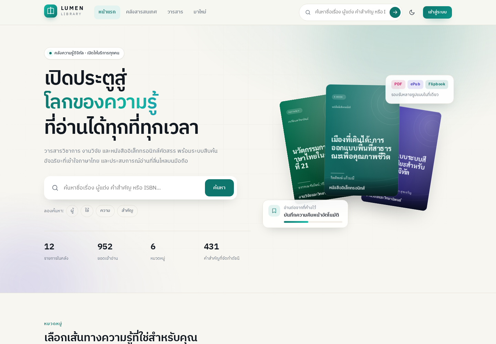

# Nakhonmaesot Library

ศูนย์รวมวารสาร งานวิจัย และหนังสืออิเล็กทรอนิกส์ พร้อมระบบสืบค้นอัจฉริยะภาษาไทย
ระบบจัดการเนื้อหา สิทธิ์การเข้าถึง และแดชบอร์ดสถิติสำหรับผู้บริหาร/บรรณาธิการ



## คุณสมบัติหลัก

- **อ่านออนไลน์ได้ทุกอุปกรณ์** — รองรับ PDF (เลื่อนต่อเนื่อง/พลิกหน้า), ePub (แยกบท พร้อมปรับขนาดตัวอักษรและธีม) และ Flipbook จากไฟล์ ZIP ของรูปภาพ
- **ระบบจัดการเนื้อหา** — อัปโหลดไฟล์, สร้าง/แก้ไข/เผยแพร่, จัดหมวดหมู่และแท็ก, สร้างปกอัตโนมัติเมื่อไม่แนบรูปปก
- **สืบค้นอัจฉริยะ** — ตัดคำภาษาไทยด้วย `Intl.Segmenter`, จัดทำดัชนีคำสำคัญจากเนื้อหาในไฟล์, จัดอันดับความเกี่ยวข้อง, ค้นหาขั้นสูง (ผู้แต่ง ปี ISSN/ISBN สำนักพิมพ์ ภาษา), คำแนะนำการค้นหา
- **สิทธิ์การใช้งาน 3 ระดับ** — ผู้ดูแลระบบ (Admin), ผู้เขียน/บรรณาธิการ (Editor), ผู้อ่าน (Reader)
- **แดชบอร์ดสถิติ** — ยอดเข้าชม/เข้าอ่าน/ดาวน์โหลด, แนวโน้มรายวัน, รายการยอดนิยม, สัดส่วนตามหมวดหมู่, กิจกรรมล่าสุด, คำสำคัญยอดนิยม
- **ประสบการณ์มือถือ** — เมนูด้านล่าง, ตัวกรองแบบ drawer, ปัดหน้าเพื่อเปลี่ยนหน้า, บันทึกความคืบหน้าอัตโนมัติ, โหมดมืด

## เทคโนโลยี

| ส่วน | เทคโนโลยี |
| --- | --- |
| Frontend | React 19, TypeScript, Vite, React Router 7, CSS design system (ไม่มี UI framework) |
| Backend | Express 5, `node:sqlite` (SQLite ในตัว Node.js), Multer |
| เอกสาร | `pdfjs-dist` (อ่าน/สกัดข้อความ PDF), `pdf-lib` (สร้างไฟล์ตัวอย่าง), `fflate` (ePub/ZIP) |
| ฟอนต์ | IBM Plex Sans Thai (self-hosted ใน `public/fonts`) |

## เริ่มต้นใช้งาน

```bash
npm install
npm run seed     # สร้างข้อมูลตัวอย่าง + ไฟล์ PDF/ePub (ทำครั้งแรกอัตโนมัติเมื่อเริ่มเซิร์ฟเวอร์)
npm run dev      # API :4000 + เว็บ :3000
```

เปิด http://localhost:3000

### บัญชีทดลอง

| บทบาท | อีเมล | รหัสผ่าน |
| --- | --- | --- |
| ผู้ดูแลระบบ | `admin@nakhonmaesot.app` | `Nakhonmaesot@2026` |
| ผู้เขียน/บรรณาธิการ | `editor@nakhonmaesot.app` | `Nakhonmaesot@2026` |
| ผู้อ่าน | `reader@nakhonmaesot.app` | `Nakhonmaesot@2026` |

### Production

```bash
npm run build
npm start        # เสิร์ฟ dist + API ที่พอร์ต 4000 (ปรับได้ด้วย PORT)
```

## คำสั่งที่มีให้

| คำสั่ง | รายละเอียด |
| --- | --- |
| `npm run dev` | รัน API และ Vite พร้อมกัน |
| `npm run dev:api` | รันเฉพาะ API |
| `npm run dev:web` | รันเฉพาะ frontend |
| `npm run build` | ตรวจชนิดข้อมูล (TypeScript) และ build client |
| `npm start` | รันเซิร์ฟเวอร์ production จาก `dist` |
| `npm run seed` | รีเซ็ตข้อมูลตัวอย่าง (`--force`) |
| `npm run seed:pack` | แพ็กฐานข้อมูล + ไฟล์อัปโหลดเป็นชุดนำเข้า (`public/seed`) |
| `npm run worker:build` | build เว็บ + แพ็ก seed + bundle Worker ลง `sites-build/` |
| `npm run worker:dev` | รัน Worker (D1 + R2 จำลอง) ที่พอร์ต 8789 ด้วย `wrangler dev` |
| `npm run pwa:icons` | สร้างไอคอน PWA (ต้องมี Chromium ของ Playwright) |
| `npm run pwa:shots` | ถ่ายภาพหน้าจอสำหรับ `manifest.screenshots` |
| `npm run test:pwa` | ตรวจ PWA end-to-end (manifest, service worker, แคชออฟไลน์, ปุ่มติดตั้ง) |
| `npm run test:book` | ตรวจตัวอ่านแบบหนังสือ end-to-end (ปก, การเปิดเล่ม, การพลิกหน้า, ePub, มือถือ) |

## โครงสร้างโปรเจกต์

```
worker.js             จุดเริ่มต้นของ Cloudflare Worker (Express ผ่าน cloudflare:node)
server/
  index.js            จุดเริ่มต้นฝั่ง Node: SQLite + ไฟล์ใน data/
  app.js              Express app (ใช้ร่วมกันทั้ง Node และ Worker)
  db.js               สคีมา + facade ของฐานข้อมูล (สลับไดรเวอร์ได้)
  drivers/            sqlite (Node) / d1 (Worker) และ fs / r2 สำหรับไฟล์
  storage.js          facade ของที่เก็บไฟล์อัปโหลด (`/uploads/*`)
  paths.js            ตำแหน่งโฟลเดอร์ข้อมูลฝั่ง Node
  seed-import.js      นำเข้า seed ครั้งแรกเข้า D1 + R2
  dom-polyfills.js    DOMMatrix ขนาดย่อให้ pdf.js ทำงานบน workerd
  auth.js             scrypt, session cookie, middleware สิทธิ์
  indexer.js          สกัดข้อความ PDF/ePub/ZIP + ตัดคำไทย + ดัชนีคำสำคัญ
  search.js           ค้นหา/จัดอันดับ/ facets / autocomplete
  covers.js           สร้างปก SVG อัตโนมัติ
  seed.js             ข้อมูลตัวอย่าง 14 รายการ + สถิติ 45 วัน
  routes/             auth, publications, taxonomy, users, analytics, discover
src/
  pages/              หน้าเว็บและหน้าผู้ดูแล
  components/         UI, ชาร์ต SVG, BookReader/PdfReader, หน้าหนังสือ
  lib/                API client, auth context, toast, types, paginate (แบ่งหน้าหนังสือ)
data/                 SQLite + ไฟล์อัปโหลด (สร้างอัตโนมัติ, ไม่ควร commit)
public/fonts/         ฟอนต์ไทย self-hosted
scripts/              สคริปต์เก็บภาพหน้าจอด้วย Playwright
```

## ติดตั้งเป็นแอป (PWA)

เว็บนี้ติดตั้งลงหน้าจอโฮมของ Android และ iOS ได้ พร้อมเปิดแบบเต็มจอ (standalone)

- **Android / Chrome / Edge**: มีแบนเนอร์ “ติดตั้ง Nakhonmaesot Library” ในแอป หรือใช้เมนูเบราว์เซอร์ → *ติดตั้งแอป*
- **iOS / Safari**: แตะปุ่มแชร์ → *เพิ่มไปยังหน้าจอโฮม* (แอปจะแสดงขั้นตอนให้ในแบนเนอร์)
- ทุกหน้าเข้าถึงได้แม้ไม่มีเน็ตในโหมดอ่านจากแคช (หน้าที่เคยเปิด) ส่วน `/api` จะไม่ถูกแคชเลยเพื่อความปลอดภัยของข้อมูลบัญชี

ไฟล์ที่เกี่ยวข้อง: `public/manifest.webmanifest`, `public/sw.js`, `public/offline.html`, `src/lib/pwa.ts`, `src/components/Pwa.tsx`

ตรวจสอบอัตโนมัติ (ต้อง build ก่อน และมี Chromium ของ Playwright):

```bash
npm run build
PORT=4100 node server/index.js &
export LD_LIBRARY_PATH="$PWD/.local-libs/usr/lib/x86_64-linux-gnu:$LD_LIBRARY_PATH"
export FONTCONFIG_FILE="$PWD/.local-libs/fonts.conf"
node scripts/pwa-check.mjs http://localhost:4100
```

## ตัวอ่านแบบหนังสือ (Book reader)

ทุกเล่มที่กด “อ่านออนไลน์” จะเปิดเป็นหนังสือจริง ไม่ว่าไฟล์ต้นฉบับจะเป็น PDF, ePub หรือ Flipbook

- **เปิดเล่ม**: หน้าปกวางอยู่บนโต๊ะ (เอียง 3D มีสันหนังสือและขอบกระดาษ) กด **เปิดอ่าน** หรือคลิกที่ปก แล้วปกจะหมุนออกเผยให้เห็นหน้าภายในเล่ม
- **กางสองหน้า**: หน้าแรกอยู่ด้านขวา ข้างซ้ายเป็นหน้าลิขสิทธิ์/ในปก หลังจากนั้นจับคู่หน้า (2–3), (4–5) … เหมือนหนังสือพิมพ์จริง
- **พลิกหน้า**: ลากหน้ากระดาษด้วยเมาส์/นิ้ว (ปล่อยเกินครึ่งจะพลิกจริง), คลิกครึ่งซ้าย/ขวาของเล่ม, ปุ่มลูกศร หรือ `←` `→` — หน้าเดิมม้วนเป็นกระดาษจริง แบ่งเป็นแถบแนวดิ่ง 10–20 แถบที่เอียงไล่กัน (โค้งสูงสุด 34°) ขอบปลิวนำและขอบสันตามหลัง แต่ละแถบถูกฉายเป็นชิ้นแบนตามสัดส่วน `cos` ของมุมตัวเอง จึงต่อกันสนิทไม่เกิดขั้นบันไดจาก perspective และแรเงาด้วยโทนแบนต่อแถบที่ต่างกันไม่เกิน 1 ระดับสี (ไม่เป็นลายแถบ) เงาที่ขอบปลิวจางลงเมื่อแผ่นกระดาษตั้งฉาก การเคลื่อนไหวขับด้วย `requestAnimationFrame` (วัดได้ 60fps) การ์ดปกยังหมุนเป็นแผ่นแข็งเหมือนเดิม — ทั้งการเปิดปกและการพลิกหน้าใช้เวลา 1.15 วินาที ให้อ่านเป็นการพลิกกระดาษจริง ๆ ไม่ใช่การสลับหน้าจอ
- **เสียงกระดาษ**: ทุกการเปิดปก/พลิกหน้า (รวมการลากปล่อยให้เด้งกลับ) เล่นเสียงกระดาษเบา ๆ สังเคราะห์จาก Web Audio (แบนด์พาสที่กวาดความถี่ตามการปลิว ไม่มีไฟล์เสียงต้องโหลด) — ปิด/เปิดได้จากปุ่มลำโพงในแถบเครื่องมือด้านบน และจำค่าไว้ใน `localStorage` (`nakhonmaesot-book-sound`) ค้างไว้
- **ePub**: เนื้อหาถูกแบ่งเป็นหน้าตามขนาดหน้ากระดาษจริง (วัดด้วย DOM) มีหัวกระดาษและเลขหน้า และแบ่งใหม่เมื่อเปลี่ยนขนาดตัวอักษรหรือขนาดหน้าต่าง
- **หน้าจอเล็ก**: เปลี่ยนเป็นทีละหน้าอัตโนมัติ (ไม่บีบสองหน้าให้อ่านไม่ออก)
- **PDF**: เรนเดอร์ผ่าน pdf.js เป็นภาพต่อหน้า แคชหน้าไว้ 28 หน้า และแสดงเฉพาะหน้าปัจจุบัน ± รอบข้าง
- **เต็มจอ**: ปุ่มในแถบเครื่องมือใช้ได้ทั้งมือถือและเดสทอป — เดสทอป/Android เข้าโหมด fullscreen ของเบราว์เซอร์ ส่วนเบราว์เซอร์ที่ไม่มี Fullscreen API (เช่น iOS Safari) จะเปลี่ยนเป็นโหมดเต็มจอเอง: ปรับความสูงตาม viewport ที่เห็นจริง แถบเครื่องมือลอยทับหน้าแล้วซ่อนเองหลังไม่แตะ 3 วินาที (แตะจอเพื่อเรียกกลับ หรือกด `Esc`)
- ความคืบหน้า/สารบัญ/บุ๊กมาร์ก/ดาวน์โหลด ยังทำงานเหมือนเดิม และมีปุ่มดูปกเพื่อเปิดเล่มใหม่ได้จากแผงตั้งค่า

ไฟล์ที่เกี่ยวข้อง: `src/components/BookReader.tsx`, `src/components/CurlLeaf.tsx`, `src/components/BookPages.tsx`, `src/lib/paginate.ts`, `src/pages/Reader.tsx`

ตรวจสอบอัตโนมัติ (Chromium ของ Playwright):

```bash
npm run dev            # หรือ npm run build && PORT=4100 node server/index.js
npm run test:book -- http://localhost:3000
```

## ดีพลอยขึ้น Cloudflare (Workers + D1 + R2)

แอปเดียวกันนี้รันบน Cloudflare Workers ได้โดยไม่ต้องมีเซิร์ฟเวอร์ Node:

| ส่วน | ฝั่ง Node (dev) | ฝั่ง Cloudflare |
| --- | --- | --- |
| HTTP | Express 5 บน `http.listen` | Express 5 บน `cloudflare:node` (`handleAsNodeRequest`) |
| ฐานข้อมูล | `node:sqlite` ใน `data/nakhonmaesot.db` | D1 (binding `DB`) |
| ไฟล์อัปโหลด | โฟลเดอร์ `data/uploads` | R2 (binding `FILES`) เสิร์ฟผ่าน `/uploads/*` |
| หน้าเว็บ | `dist` ผ่าน `express.static` | Static assets (binding `ASSETS`) + SPA fallback ใน Worker |

```bash
npm run worker:build     # build dist + แพ็ก seed + bundle Worker -> sites-build/worker.js
npm run worker:dev       # ทดสอบ Worker ในเครื่อง (D1/R2 จำลองที่ .wrangler/state)
```

ครั้งแรกที่ Worker ทำงาน ระบบจะสร้างสคีมาบน D1 แล้วนำเข้าข้อมูลตัวอย่างจาก `public/seed`
(ฐานข้อมูล ~3,000 แถว + ไฟล์อัปโหลด 36 ไฟล์) การนำเข้าจะบันทึก fingerprint ลงตาราง `seed_state`
เมื่อครบ คำขอถัดไปจะข้ามทันที ไฟล์ใน R2 เติมเฉพาะที่ยังขาด ทำให้ import ที่ค้างทำต่อได้

ถ้านำเข้าไม่ครบ (เช่น โดนพักเพราะโควตา) รอบถัดไปจะลบตารางข้อมูลแล้วนำเข้าชุดใหม่ทั้งหมด
เพื่อไม่ให้เหลือข้อมูลครึ่งกลาง — แต่จะไม่แตะฐานที่มีผู้ใช้เกินจำนวนที่ชุด demo มีให้

> โควตาฟรีของ D1 จำกัด **10,000 แถวที่เขียนต่อวัน** — ชุด seed ถูกย่อให้อยู่ในงบนี้แล้ว
> ถ้าเว็บถูกพักเพราะโควตารายวัน ให้รอรอบรีเซ็ต (00:00 UTC) แล้ว deploy ใหม่

ไฟล์ที่ใช้ดีพลอย: `sites.deploy.json` (manifest) + `sites-build/worker.js` + `dist/`

## การทำงานของระบบสืบค้น

1. เมื่ออัปโหลดไฟล์ ระบบจะสกัดข้อความ (PDF ผ่าน pdf.js, ePub ผ่าน OPF/spine, ZIP ผ่านรายชื่อรูป)
2. ตัดคำภาษาไทย/อังกฤษด้วย `Intl.Segmenter` และตัดคำหยุด (stopwords)
3. บันทึกดัชนีแบบ inverted index (`keywords`) พร้อมน้ำหนักคำที่ปรากฏในชื่อเรื่อง
4. ค้นหาแบบ prefix + คำนวณ TF-IDF อย่างง่าย ผสานการเพิ่มน้ำหนักเมื่อคำตรงกับชื่อเรื่อง/ผู้แต่ง
5. แสดง snippet รอบคำที่พบ และ facets สำหรับตัวกรองขั้นสูง

> หมายเหตุ: ไฟล์ ZIP สำหรับ Flipbook จะเรียงหน้าตามชื่อไฟล์แบบ natural sort และรองรับ JPG, PNG, WebP, GIF, AVIF

## สิทธิ์การเข้าถึง

| การกระทำ | Reader | Editor | Admin |
| --- | :-: | :-: | :-: |
| เปิดอ่าน/ดาวน์โหลดเอกสารที่เผยแพร่ | ✓ | ✓ | ✓ |
| บันทึกชั้นหนังสือ/ความคืบหน้า | ✓ | ✓ | ✓ |
| เพิ่ม/แก้ไขเนื้อหา | — | เฉพาะที่สร้าง | ✓ |
| ลบเนื้อหา | — | เฉพาะที่สร้าง | ✓ |
| จัดการหมวดหมู่/แท็ก | — | ✓ | ✓ |
| ดูแดชบอร์ดสถิติ | — | ✓ | ✓ |
| จัดการผู้ใช้และสิทธิ์ | — | — | ✓ |

## ข้อควรทราบ

- ฝั่ง Node: ฐานข้อมูลและไฟล์อัปโหลดอยู่ใน `data/` (SQLite WAL + โฟลเดอร์ `uploads/`)
- ฝั่ง Cloudflare: ข้อมูลอยู่ใน D1 และไฟล์อยู่ใน R2 (ดูหัวข้อดีพลอย)
- ไฟล์อัปโหลดสูงสุด 300 MB ต่อไฟล์ (บน Workers จำกัด 64 MB เพราะหน่วยความจำของ isolate)
- ระบบใช้ session cookie แบบ HttpOnly; ตั้ง `COOKIE_SECURE=false` เฉพาะเมื่อรันบน HTTP ในเครื่อง
- ข้อมูลตัวอย่างและสถิติถูกสร้างใหม่ได้ด้วย `npm run seed`

## ดีพลอยบน Vercel (จาก GitHub)

โค้ดชุดนี้พร้อมให้ Vercel ดีพลอยจาก repository ที่เชื่อมกับ Freebuff โดยตรง:
frontend ถูก build เป็น static (Vite → `dist/`) และ API ทั้งหมดรันเป็น Vercel
Function ตัวเดียวที่ `api/index.mjs` (Express ตัวเดิม) — ไม่ต้องแก้ route ใด ๆ

เนื่องจาก Vercel Function อ่านไฟล์ใน bundle ได้อย่างเดียวและไม่มีดิสก์ถาวร
ระบบจึงใช้บริการคลาวด์แทนไฟล์ในเครื่อง:

| ส่วน | บน Vercel | ตัวแปรสภาพแวดล้อม |
| --- | --- | --- |
| ฐานข้อมูล | Turso (libSQL — ภาษา SQL เดียวกับ SQLite) | `TURSO_DATABASE_URL`, `TURSO_AUTH_TOKEN` |
| ไฟล์อัปโหลด/ปก/PDF | Vercel Blob (แนะนำ) หรือตาราง `upload_objects` ใน Turso | `BLOB_READ_WRITE_TOKEN` (ไม่บังคับ) |

การเลือกที่เก็บไฟล์ทำอัตโนมัติ: ถ้ามี `BLOB_READ_WRITE_TOKEN` จะใช้ Blob,
ถ้าไม่มีจะเก็บไฟล์ในฐานข้อมูล Turso แทน (ดิสก์ของ Function เขียนไม่ได้)
กำหนดเองได้ด้วย `FILE_STORAGE=auto|blob|db|fs`

Blob store ต้องสร้างเป็นแบบ **Public** ถ้าต้องการให้ไฟล์ใหญ่ถูกส่งต่อผ่าน CDN
(โหมด Public/Private เปลี่ยนภายหลังไม่ได้) — โค้ดรองรับทั้งสองแบบ: store แบบ private
จะถูกอ่านผ่าน proxy `/uploads/*` แบบ Range request แทน

### ขั้นตอน

1. สร้างฐานข้อมูล Turso ผ่าน Vercel → Storage (Marketplace) แล้วเชื่อมกับโปรเจกต์
   — Vercel จะใส่ `TURSO_DATABASE_URL` และ `TURSO_AUTH_TOKEN` ให้เอง
2. (ไม่บังคับ) สร้าง Blob store (Vercel → Storage → Blob) แล้วเชื่อมกับโปรเจกต์
   — จะได้ `BLOB_READ_WRITE_TOKEN`; ถ้าไม่มี ระบบจะเก็บไฟล์ในฐานข้อมูลให้เลย
3. Import repository นี้ใน Vercel แล้วกด Deploy

`vercel.json` ตั้งค่า build ไว้เป็น `npm run build && node scripts/seed-cloud.mjs`
ตัว seed จะสร้าง schema และข้อมูลตัวอย่าง (ผู้ใช้ 6 คน, หมวดหมู่, หนังสือ 25 เล่ม
พร้อมไฟล์ PDF/ePub) ลง Turso และคัดลอกไฟล์เข้า backend ที่เลือกไว้ **ครั้งเดียว** — ถ้าฐานข้อมูลมี
ผู้ใช้อยู่แล้วจะข้ามทันที จึงไม่เปลืองการเขียนซ้ำทุกครั้งที่ build

### ข้อจำกัดที่ต่างจากเวอร์ชัน Cloudflare/เครื่อง Local

- Request/response ของ Vercel Function จำกัด **4.5 MB**: การอัปโหลดจึงแบ่งเป็นชิ้น
  (chunked) และการอ่าน/ดาวน์โหลดใช้ Range request ทำให้หนังสือไฟล์ใหญ่ใช้งานได้
- ไฟล์ที่ใหญ่กว่า 4 MB จะถูกส่งต่อ (302) ไปยัง CDN เมื่อใช้ Blob store แบบ public;
  ถ้าใช้ store แบบ private หรือเก็บในฐานข้อมูล ไฟล์จะถูกอ่านผ่าน proxy แบบช่วง
- ฐานข้อมูลต้องมีผู้ใช้อย่างน้อย 1 คนจากขั้นตอน seed; ถ้าไม่ได้ตั้งค่า
  `TURSO_DATABASE_URL` ฝั่ง API จะตอบ 503 พร้อมข้อความบอกการตั้งค่า
